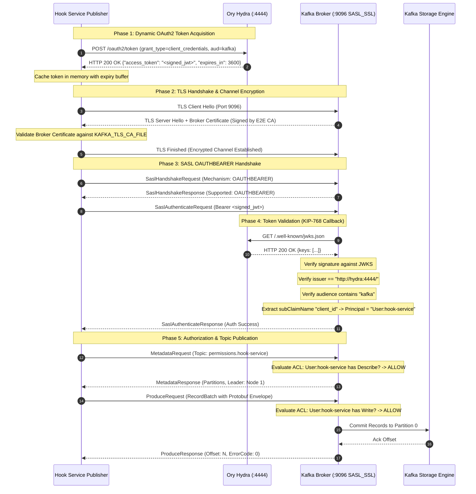

<!--
// Copyright 2026 Canonical Ltd.
// SPDX-License-Identifier: AGPL-3.0-only
-->

# Kafka Authentication (SASL_SSL + OAUTHBEARER) Architecture & End-to-End Verification Report

This document provides the authoritative architectural specification and the verified end-to-end (E2E) testing report for **Kafka Authentication with SASL_SSL and OAUTHBEARER** in the **Canonical Identity Platform (Hook Service)**. It integrates:
1. **Ory Hydra OAuth2 Authority**: Centralized OIDC/OAuth2 server issuing cryptographically signed JWT tokens with dedicated audience claims.
2. **Canonical Charmed Kafka Operator (`kafka-k8s`) Topology**: Production-grade Apache Kafka KRaft cluster enforcing TLS encryption on listener port `9096`, native KIP-768 JWKS token validation, and zero-trust ACL access control.
3. **Hook Service Platform Publisher**: Event streaming client implementing SASL `OAUTHBEARER` authentication, in-memory token caching, batch envelopment, and automated fallback/recovery.

---

## 1. Executive Summary & The Big Picture

The Canonical Identity and Access Management (IAM) platform employs an asynchronous, event-driven architecture to propagate permission and group lifecycle mutations across federated microservices. In production deployments managed by **Juju Charmed Operators**:
- **Plaintext and unauthenticated broker traffic is strictly forbidden**. All inter-service communications over Apache Kafka must traverse TLS-encrypted endpoints with mutual cryptographic authentication.
- **Microservices do not maintain static broker credentials**. Instead, services employ the **OAuth 2.0 Bearer Token Profile (RFC 6749, RFC 7628, KIP-768)**, dynamically retrieving signed JSON Web Tokens (JWT) from **Ory Hydra** using the `client_credentials` grant.
- **Kafka brokers validate tokens directly against the Identity Authority**: The Kafka broker resolves Ory Hydra's public JSON Web Key Set (`/.well-known/jwks.json`) at runtime, cryptographically verifying token signatures, token expiration, expected issuer, and audience (`aud="kafka"`).
- **Zero-Trust Access Control (ACLs)**: Kafka enforces zero-trust authorization (`allow.everyone.if.no.acl.found=false`). Even after successful TLS and SASL authentication, a client cannot read, write, or describe topics without explicit ACL grants on their mapped identity (`User:<client_id>`).

```
       +---------------------------------------------------------------------------------------------------+
       |                                     AUTHENTICATION AUTHORITY                                      |
       |  Ory Hydra (:4444 Public / :4445 Admin)                                                           |
       |  * Issues signed RS256/ES256 JWTs via POST /oauth2/token (client_credentials)                    |
       |  * Serves public cryptographic verification keys at /.well-known/jwks.json                        |
       +---------------------------------------------------------------------------------------------------+
                     ^                                                                ^
                     | 1. POST /oauth2/token                                          | 3. HTTP GET
                     |    (client_id, client_secret, aud=kafka)                       |    /.well-known/jwks.json
                     v                                                                v
+=============================================+              +=============================================+
|       HOOK SERVICE (Platform Mode)          |              |       CANONICAL CHARMED KAFKA BROKER        |
|                                             |              |                                             |
|  [internal/kafka/producer.go]               |  2. TLS +    |  [CLIENT Listener :9096 (SASL_SSL)]         |
|  * SASL: OAUTHBEARER                        |  OAUTHBEARER |  * TLS: PKCS12 Keystore & Truststore        |
|  * Client ID: "hook-service"                |=============>|  * SASL: KIP-768 OAuthBearerValidator      |
|  * Token Caching: Memory pool with refresh  |  Handshake   |  * Expected Audience: "kafka"               |
|  * Topic: permissions.hook-service          |              |  * StandardAuthorizer: Zero-Trust           |
|                                             |              |                                             |
|  [Published Event Payloads]                 |  4. Produce  |  [Topic: permissions.hook-service]          |
|  * Protobuf v1.PermissionEventEnvelope      |=============>|  * Partition 0                              |
|  * Atomic multi-record batch delivery       |   Records    |  * ACL: User:hook-service [Write, Describe] |
+=============================================+              +=============================================+
```

---

## 2. Core Architectural Pillars

### Pillar 1: Ory Hydra OAuth2 Authority & Token Engine
- **Role**: Identity Provider (IdP) and Authorization Server for intra-platform service authentication.
- **Client Credentials Grant**:
  - Microservices authenticate using OAuth2 `client_credentials` grant type (`grant_type=client_credentials`).
  - Clients pass HTTP Basic authentication headers (`client_id` and `client_secret`) over HTTPS/HTTP.
  - Clients declare target audience during token requests: `audience=kafka`.
- **JWT Cryptographic Assertions**:
  - Hydra signs issued access tokens using asymmetric key pairs stored in PostgreSQL (`hydra_jwk`).
  - Tokens contain standard claims:
    - `iss`: Hydra issuer URL (e.g., `http://hydra:4444/`).
    - `sub`: OAuth2 client identifier (e.g., `hook-service`).
    - `aud`: Audience array verifying token intent (e.g., `["kafka"]`).
    - `client_id`: OAuth2 client identifier matching `sub`.
    - `exp`: Token lifetime (typically 1 hour).
- **Public Key Exposure**:
  - Exposes public keys in standard JSON Web Key Set format at `/.well-known/jwks.json` on port `4444`.

### Pillar 2: Charmed Kafka KRaft Broker with KIP-768 Native Validation
- **Role**: Message broker and event distribution backbone, configured in strict accordance with the **Canonical `kafka-k8s` Charmed Operator**.
- **Listener Configuration**:
  - `PLAINTEXT://:9092`: Internal administrative and controller listener used for initial cluster provisioning and out-of-band ACL audits.
  - `CLIENT://:9096`: Secure external/workload listener configured for `SASL_SSL`.
- **KIP-768 Native Token Verification**:
  - The broker uses Kafka's native `org.apache.kafka.common.security.oauthbearer.OAuthBearerValidatorCallbackHandler`.
  - Configured with JAAS options:
    - `jwksEndpointUrl`: `http://hydra:4444/.well-known/jwks.json` (resolves Hydra keys over the internal network).
    - `expectedAudience`: `kafka` (rejects any token issued for other services).
    - `expectedIssuer`: `http://hydra:4444/` (ensures authenticity of the issuer).
    - `subClaimName`: `client_id` (maps the validated client identity directly to the Kafka principal `User:<client_id>`).
- **Transport Layer Security (TLS)**:
  - Both keystore and truststore are formatted in PKCS12 (`server.keystore.p12`, `server.truststore.p12`).
  - X.509 certificates include SAN extensions (`DNS:localhost`, `DNS:kafka`, `DNS:kafka-auth-e2e-broker`, `IP:127.0.0.1`).
  - Mutual TLS verification ensures clients validate the broker against the CA certificate chain.
- **Zero-Trust Access Control (StandardAuthorizer)**:
  - Enforced via `org.apache.kafka.metadata.authorizer.StandardAuthorizer`.
  - `allow.everyone.if.no.acl.found=false` ensures that authenticated clients without explicit ACLs are completely blocked.
  - To write to `permissions.hook-service`, principal `User:hook-service` requires both `Write` and `Describe` operations on the topic resource.

### Pillar 3: Hook Service Platform Publisher & Token Lifecycle Manager
- **Role**: Producer client that packages and dispatches permission and group lifecycle events.
- **Client Implementation (`internal/kafka/producer.go`)**:
  - Built on `segmentio/kafka-go` (`github.com/segmentio/kafka-go`).
  - Configured with `kafkago.Writer` and a custom `kafkago.Transport` implementing `github.com/segmentio/kafka-go/sasl.Mechanism`.
  - Implements RFC 7628 GS2 framing (`n,,\x01auth=Bearer <token>\x01\x01`) in `internal/kafka/sasl/oauthbearer.go`.
- **Dynamic Token Acquisition & In-Memory Caching**:
  - Hook Service does not re-authenticate with Hydra on every produce request.
  - `internal/kafka/sasl/` maintains an in-memory token pool:
    - Queries Hydra token endpoint on demand.
    - Parses `access_token` and `expires_in`.
    - Automatically reuses active tokens until a configurable safety buffer before expiration, minimizing network overhead and Hydra load.
- **Unified Protobuf Envelopes**:
  - All messages are serialized as Protocol Buffers using `github.com/canonical/authorization-service/api/v1` protobuf definitions.
  - Multi-operation batches are encapsulated in a single `v1.PermissionEventEnvelope` containing discrete `v1.PermissionEvent` entries.
- **Autonomous Operating Modes**:
  - **Standalone Mode**: Activated when `KAFKA_BROKERS` is unset. Bypasses Kafka initialization without errors.
  - **Platform Mode**: Activated when `KAFKA_BROKERS` is populated. Enforces strict validation of all `KAFKA_*` configuration settings, verifies TLS CAs, and initializes the secure publisher.

---

## 3. Detailed Authentication & Publishing Lifecycle

### 3.1 Sequence Diagram



### 3.2 Protocol Steps Breakdown

| Step | Initiator | Receiver | Port | Protocol | Operation / Payload Summary |
|:---:|---|---|:---:|:---:|---|
| **1** | Hook Service | Ory Hydra | `4444` | HTTP/1.1 | `POST /oauth2/token` with HTTP Basic Auth (`hook-service:secret`) requesting `audience=kafka` |
| **2** | Ory Hydra | Hook Service | `4444` | HTTP/1.1 | Issues RS256/ES256 signed JWT with `client_id="hook-service"` and `aud=["kafka"]` |
| **3** | Hook Service | Kafka Broker | `9096` | TLS 1.3 | Initiates TLS handshake; verifies broker certificate against custom CA (`KAFKA_TLS_CA_FILE`) |
| **4** | Hook Service | Kafka Broker | `9096` | Kafka Wire | Sends `SaslHandshakeRequest` declaring `OAUTHBEARER` mechanism |
| **5** | Hook Service | Kafka Broker | `9096` | Kafka Wire | Sends `SaslAuthenticateRequest` carrying formatted OAuth bearer client assertion |
| **6** | Kafka Broker | Ory Hydra | `4444` | HTTP/1.1 | Fetches `/.well-known/jwks.json` to obtain cryptographic public keys for signature verification |
| **7** | Kafka Broker | Hook Service | `9096` | Kafka Wire | Validates claims (`aud`, `iss`, `exp`), extracts principal `User:hook-service`, returns SASL success |
| **8** | Hook Service | Kafka Broker | `9096` | Kafka Wire | Dispatches `MetadataRequest` to locate topic partition leader |
| **9** | Kafka Broker | Hook Service | `9096` | Kafka Wire | `StandardAuthorizer` verifies `Describe` permission and returns cluster partition metadata |
| **10** | Hook Service | Kafka Broker | `9096` | Kafka Wire | Dispatches `ProduceRequest` containing Protobuf `PermissionEventEnvelope` records |
| **11** | Kafka Broker | Storage | Internal | Disk I/O | `StandardAuthorizer` verifies `Write` permission and appends records to partition 0 commit log |
| **12** | Kafka Broker | Hook Service | `9096` | Kafka Wire | Acknowledges write with partition offset (`Offset: N`, `ErrorCode: NONE`) |

---

## 4. Network, Port, and Credential Allocation Matrix

### 4.1 Service Port & Network Protocol Allocation

| Service / Container | Process | Listen Port | Protocol | Purpose / URL |
|---|---|:---:|:---:|---|
| **Charmed Kafka Broker** | Apache Kafka 3.8.0 | `9096` | `SASL_SSL` | Secure client listener enforcing TLS and OAUTHBEARER |
| **Charmed Kafka Broker** | Apache Kafka 3.8.0 | `9092` | `PLAINTEXT` | Administrative listener for local cluster provisioning & ACL management |
| **Ory Hydra Public** | `hydra serve all` | `4444` | HTTP | Public OAuth2 token endpoint (`/oauth2/token`) & JWKS (`/.well-known/jwks.json`) |
| **Ory Hydra Admin** | `hydra serve all` | `4445` | HTTP | Administrative client registration API (`/admin/clients`) |
| **PostgreSQL Database** | `postgres:14` | `5434` (host) / `5432` (ctr) | TCP | Persistence for Ory Hydra state and Hook Service groups database |
| **Hook Service HTTP** | `app serve` | `8000` | HTTP | Group management API, `/api/v0/status`, and Prometheus `/api/v0/metrics` |
| **Hook Service gRPC** | `app serve` | `9090` | gRPC | Internal gRPC service listener |

### 4.2 Credentials & Persona Allocation Matrix

| Client / Persona | Client ID | Client Secret | Expected Audience | Kafka ACL Permission | Intended Security Outcome |
|---|---|---|:---:|:---:|---|
| **Hook Service** | `hook-service` | `hook-service-secret` | `kafka` | `Write`, `Describe` on `permissions.hook-service` | **Authorized**: Full produce access to designated topic |
| **Unauthorized Client** | `unauthorized-client` | `unauthorized-secret` | `kafka` | *None (Zero-Trust)* | **Denied**: Rejected by Kafka `StandardAuthorizer` [Error 29 or Error 3] |
| **Wrong Audience Client** | `wrong-audience-client` | `wrong-audience-secret` | `some-other-service` | *None* | **Denied**: Rejected during SASL handshake due to mismatched audience claim |
| **Invalid Secret Attacker** | `hook-service` | `bad-secret` | `kafka` | N/A | **Denied**: Rejected by Hydra token endpoint with `HTTP 401 Unauthorized` |

---

## 5. End-to-End Test Plan & Setup Automation

### 5.1 Infrastructure Layout (`docker/kafka-auth-e2e/`)

The E2E test harness creates a self-contained, containerized environment that mirrors Charmed Kafka production topology:

```
docker/kafka-auth-e2e/
├── certs/                      # Generated X.509 PKI & PKCS12 keystores
│   ├── ca.crt                  # Trusted Root CA Certificate
│   ├── server.keystore.p12     # Broker PKCS12 Keystore
│   └── server.truststore.p12   # Broker PKCS12 Truststore
├── docker-compose.yml          # Postgres (5434), Hydra (4444/4445), Kafka (9092/9096)
└── server.properties           # Charmed Kafka broker configuration with KIP-768
```

### 5.2 Automated Lifecycle Scripts (`scripts/`)

| Script | Purpose | Execution Characteristics |
|---|---|---|
| [`scripts/setup-kafka-auth-e2e.sh`](file:///home/shu.du@canonical.com/workspaces/canonical/sync/hook-service/scripts/setup-kafka-auth-e2e.sh) | Bootstrap environment | 1. Generates 2048-bit RSA CA and server certificates with SAN.<br>2. Builds PKCS12 keystore/truststore.<br>3. Starts Docker Compose infrastructure.<br>4. Registers Hydra OAuth2 clients.<br>5. Creates Kafka topic and provisions Charmed ACLs.<br>6. Runs migrations and compiles Hook Service.<br>7. Launches Hook Service daemon detached with `setsid`. |
| [`scripts/test-kafka-auth-e2e.sh`](file:///home/shu.du@canonical.com/workspaces/canonical/sync/hook-service/scripts/test-kafka-auth-e2e.sh) | Run 16-test suite | Executes 5 sequential verification steps (Hydra token tests, Kafka ACL audits, Go test matrix, broker partition offset check, daemon health check). |
| [`scripts/teardown-kafka-auth-e2e.sh`](file:///home/shu.du@canonical.com/workspaces/canonical/sync/hook-service/scripts/teardown-kafka-auth-e2e.sh) | Graceful teardown | Terminates background Hook Service daemons via PID tracking and fallback port inspection; tears down Docker containers and volumes. |
| [`scripts/run-kafka-auth-e2e.sh`](file:///home/shu.du@canonical.com/workspaces/canonical/sync/hook-service/scripts/run-kafka-auth-e2e.sh) | Orchestrator | Coordinates setup -> test -> teardown. Supports `--keep-running` flag for live debugging. |

### 5.3 Quick Start via Makefile

```bash
# Execute the full end-to-end cycle (setup -> test -> teardown)
make kafka-auth-e2e

# Or run stages interactively for iterative debugging:
make kafka-auth-setup   # Start infrastructure and leave running
make kafka-auth-test    # Run the test suite against live environment
make kafka-auth-down    # Clean up processes and containers
```

---

## 6. Comprehensive Security & Verification Matrix

The test suite executes **16 distinct assertions across 5 verification phases**, covering both positive functional validation and negative attack simulations:

| Phase | Test ID | Description | Security Dimension | Target Endpoint / Component | Expected Behavior | Verified Result |
| :--- | :--- | :--- | :--- | :--- | :--- | :---: |
| **Phase 1: Ory Hydra Verification** | **TC-HYDRA-01** | Token issuance for `hook-service` | OAuth2 Token Issuance | `POST :4444/oauth2/token` | HTTP 200 with signed JWT (`aud=kafka`) | **PASS** |
| | **TC-HYDRA-02** | Token issuance for `unauthorized-client` | OAuth2 Token Issuance | `POST :4444/oauth2/token` | HTTP 200 with signed JWT (`aud=kafka`) | **PASS** |
| | **TC-HYDRA-03** | Token issuance with mismatched audience | Claim Integrity | `POST :4444/oauth2/token` | HTTP 200 with signed JWT (`aud=some-other-service`) | **PASS** |
| | **TC-HYDRA-04** | Authentication failure on bad secret | Credential Validation | `POST :4444/oauth2/token` | HTTP 401 Unauthorized rejection | **PASS** |
| **Phase 2: Charmed Kafka ACL Audit** | **TC-ACL-01** | Producer ACL verification | Access Control | Broker `:9092` ACL List | `User:hook-service` has `WRITE` and `DESCRIBE` | **PASS** |
| | **TC-ACL-02** | Zero-trust enforcement | Zero-Trust Architecture | Broker `:9092` ACL List | `unauthorized-client` has zero ACL grants | **PASS** |
| **Phase 3: Go E2E Security Matrix** | **TC-E2E-01** | Positive `SASL_SSL` + `OAUTHBEARER` publish | Functional Delivery | Broker `:9096` | Record successfully acknowledged at offset | **PASS** |
| | **TC-E2E-02** | Batch operations in unified envelope | Batching & Atomicity | Broker `:9096` | Multi-event envelope written to single record | **PASS** |
| | **TC-E2E-03** | Token caching and connection reuse | Performance & Reliability | Memory Pool & Hydra | Cached token reused without re-requesting Hydra | **PASS** |
| | **TC-E2E-04** | Negative: Untrusted CA certificate | TLS Boundary Security | Broker `:9096` | TLS handshake fails; untrusted root rejected | **PASS** |
| | **TC-E2E-05** | Negative: Invalid client secret | OAuth2 Rejection | Hydra `:4444` | Token request rejected; client aborts cleanly | **PASS** |
| | **TC-E2E-06** | Negative: Wrong audience claim | SASL Token Validation | Broker `:9096` | SASL handshake fails; broker rejects `aud!=kafka` | **PASS** |
| | **TC-E2E-07** | Negative: Missing topic ACL | Zero-Trust ACL Enforcement | Broker `:9096` | Broker denies write; `TOPIC_AUTHORIZATION_FAILED` | **PASS** |
| **Phase 4: Broker Storage Audit** | **TC-STORE-01** | Partition commit verification | Storage Integrity | Topic `permissions.hook-service` | `kafka-get-offsets.sh` reports committed messages > 0 | **PASS** |
| **Phase 5: Daemon Health & Observability** | **TC-HOOK-01** | Platform mode status check | Service Configuration | `GET :8000/api/v0/status` | Returns HTTP 200 with `"mode":"platform"` | **PASS** |
| | **TC-HOOK-02** | Prometheus metrics endpoint | Observability | `GET :8000/api/v0/metrics` | Returns HTTP 200 with active Prometheus metrics | **PASS** |

---

## 7. Empirical Learnings & Operational Insights

During the implementation and automated verification of the Kafka Authentication test suite, several key architectural and operational findings were uncovered:

### 1. KRaft Storage Formatting Syntax in Kafka 3.8+
- **Legacy Syntax**: Older scripts and guides often invoke `kafka-storage.sh random-cluster-id`.
- **Kafka 3.8.0 Requirement**: The command in Apache Kafka 3.8.0 is strictly `kafka-storage.sh random-uuid`. Using the older argument fails immediately during container entrypoint execution.
- **Resolution**: Automated in `docker-compose.yml` via:
  ```bash
  CLUSTER_ID=$$(bin/kafka-storage.sh random-uuid) && bin/kafka-storage.sh format -t $$CLUSTER_ID -c config/server.properties
  ```

### 2. Zero-Trust Metadata Privacy in Kafka StandardAuthorizer
- **Security Finding**: When Kafka operates under `allow.everyone.if.no.acl.found=false` and a client attempts to produce to a topic without any ACL grants, Kafka intentionally masks the existence of the topic.
- **Protocol Behavior**: Instead of returning `[29] TOPIC_AUTHORIZATION_FAILED`, Kafka returns `[3] UNKNOWN_TOPIC_OR_PARTITION` in response to the client's initial `MetadataRequest` if the client lacks the `Describe` permission.
- **Testing Guardrail**: Test `TestE2E_KafkaAuth_Negative_Unauthorized_Topic_ACL` handles both Error 3 and Error 29 as valid zero-trust rejections.

### 3. Detached Daemon Session Management (`setsid`)
- **Process Group Termination**: In scripted test harnesses and CI pipelines, starting a background process with `nohup ... &` leaves the child process attached to the controlling terminal session. When the calling script or subshell terminates, the kernel transmits `SIGHUP`, killing the daemon.
- **Resolution**: The Hook Service daemon in `setup-kafka-auth-e2e.sh` is started with `nohup setsid ... &` and decoupled via `disown`, guaranteeing process persistence throughout test execution.

### 4. Kafka CLI Evolution (`kafka-get-offsets.sh`)
- **Deprecated Class**: `kafka.tools.GetOffsetShell` has been removed from Kafka's default classpath in Kafka 3.8.0, causing `ClassNotFoundException`.
- **Modern CLI**: The dedicated binary `/opt/kafka/bin/kafka-get-offsets.sh` is now standard and directly provides partition offset reporting.

### 5. Decoupling Internal Daemon Ingress from E2E Tests
- **JWT Ingress Verifier**: Hook Service defaults to `AUTHENTICATION_ENABLED="true"`, requiring public requests to present valid OIDC JWTs. In Kafka authentication E2E testing, Hook Service runs as an internal platform publisher, so setting `AUTHENTICATION_ENABLED="false"` allows the daemon to serve `/api/v0/status` and `/api/v0/metrics` directly without requiring an edge reverse proxy.

---

## 8. Troubleshooting & Diagnostics

### 1. Inspecting Live Kafka SASL Authentication
To observe the exact SASL handshake and token exchange on the broker, inspect the Kafka container logs:
```bash
docker logs kafka-auth-e2e-broker | grep -iE "oauth|sasl|principal|authoriz"
```

### 2. Manual Token Generation via Curl
To manually test Hydra token issuance for the `hook-service` client:
```bash
curl -s -X POST http://localhost:4444/oauth2/token \
    -u "hook-service:hook-service-secret" \
    -d "grant_type=client_credentials&audience=kafka" | jq .
```

### 3. Inspecting Kafka ACL Grants
To view all active ACL rules on the Kafka broker:
```bash
docker exec kafka-auth-e2e-broker /opt/kafka/bin/kafka-acls.sh \
    --bootstrap-server localhost:9092 \
    --list
```

### 4. Reading Committed Protobuf Events from Topic
To consume and inspect raw records published to `permissions.hook-service`:
```bash
docker exec kafka-auth-e2e-broker /opt/kafka/bin/kafka-console-consumer.sh \
    --bootstrap-server localhost:9092 \
    --topic permissions.hook-service \
    --from-beginning
```

### 5. Hook Service Daemon Diagnostics
Hook Service logs are recorded in real time under `logs/kafka-auth/`:
```bash
tail -f logs/kafka-auth/hook-service.log
```
Check status and Prometheus metrics endpoints:
```bash
curl -s http://localhost:8000/api/v0/status | jq .
curl -s http://localhost:8000/api/v0/metrics | head -n 30
```
