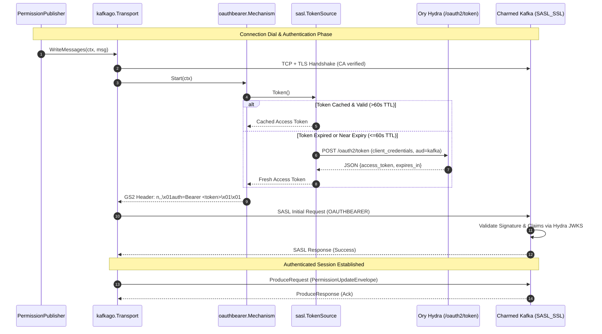

## Context

In platform deployment mode, `hook-service` acts as an event producer publishing permission synchronization envelopes (`PermissionUpdateEnvelope`) to Kafka via `internal/kafka/producer.go`. The current implementation initializes a `segmentio/kafka-go` writer using plain TCP:
```go
Addr: kafkago.TCP(brokers...)
```
In production deployments managed by Charmed Operators alongside the Canonical Identity Platform (Ory Hydra and Ory Kratos), Kafka brokers are secured using `SASL_SSL` listeners that enforce SASL/OAUTHBEARER authentication and TLS encryption. Tokens are issued by Ory Hydra via OAuth2 Client Credentials grant (`grant_type=client_credentials`), containing an audience claim `aud: ["kafka"]` and validated by Kafka against Hydra's JWKS endpoint.

Because `segmentio/kafka-go` lacks built-in SASL/OAUTHBEARER support, `hook-service` cannot currently authenticate to secure Kafka clusters. This design establishes how `hook-service` implements client-side SASL/OAUTHBEARER, in-memory token lifecycle management, and TLS transport configuration while preserving existing interfaces.

## Goals / Non-Goals

**Goals:**
- Implement a custom, RFC 7628-compliant `sasl.Mechanism` for `segmentio/kafka-go`.
- Provide thread-safe in-memory token caching and proactive renewal via `golang.org/x/oauth2/clientcredentials`.
- Support TLS configuration (`SASL_SSL`) with custom CA certificate loading.
- Enable connection recycling on `kafkago.Transport` to handle token rotation seamlessly across long-lived producer lifecycles.
- Extend `internal/config/specs.go` with validation for SASL and TLS parameters, defaulting to `none` for backward compatibility.
- Emit OpenTelemetry spans and Prometheus metrics for token acquisition and connection health.

**Non-Goals:**
- Migrating the codebase from `segmentio/kafka-go` to `twmb/franz-go` or Sarama.
- Managing OAuth2 client creation or JWKS configuration in Ory Hydra.
- Configuring Kafka broker ACLs or topic partitioning.
- Implementing in-band KIP-368 SASL re-authentication without TCP connection recycling.

## System Architecture



## Decisions

### Decision 1: Implement Custom SASL Mechanism on `segmentio/kafka-go` vs. Migrating to `franz-go`
- **Choice**: Implement `sasl.Mechanism` and `sasl.StateMachine` in `internal/kafka/sasl/` for `segmentio/kafka-go`.
- **Rationale**: `segmentio/kafka-go` exposes a minimal, pluggable 2-method SASL interface (`Name() string`, `Start(ctx) (StateMachine, []byte, error)`). The RFC 7628 wire framing is under 50 lines of pure Go. Implementing this mechanism requires zero changes to `PermissionPublisher`, writer mock generation, or test helpers.
- **Alternatives Considered**:
  - *Migrate to `twmb/franz-go`*: Provides native KIP-368 re-authentication and modern APIs, but would require rewriting `internal/kafka/producer.go`, updating all interfaces, rewriting unit/integration tests, and replacing mock generators. Rejected as disproportionate for adding SASL authentication to an existing writer.
  - *Migrate to `IBM/sarama`*: Heavy dependency with complex configuration and historical maintenance churn. Rejected.

### Decision 2: Context-Aware In-Memory Token Lifecycle with `singleflight.Group` & Proactive Renewal
- **Choice**: Implement a dedicated `TokenSource` in `internal/kafka/sasl/tokensource.go` using `golang.org/x/sync/singleflight.Group`, in-memory `sync.RWMutex` caching, and proactive early renewal ($60\text{s}$ buffer).
- **Rationale**: Kafka dials via `Transport.DialContext(ctx)`, which passes the dialer's dynamic context into `sasl.Mechanism.Start(ctx)`. `singleflight.Group.DoChan` deduplicates concurrent fetch requests into a single in-flight network call without holding a mutex across network I/O, allowing independent caller timeouts/cancellations to abort without blocking or cascading retries to other waiting dials. In-memory `sync.RWMutex` provides zero-contention fast-path reads for cached valid tokens. An early renewal margin ($60\text{s}$ buffer) ensures tokens passed to Kafka brokers have adequate remaining validity.
- **Alternatives Considered**:
  - *Standard `oauth2.ReuseTokenSource`*: Rejected because `oauth2.TokenSource.Token()` does not accept `context.Context`, which would require capturing a static `context.Background()` at startup (violating AGENTS.md anti-pattern against naked contexts) and would prevent linking OpenTelemetry child spans (`kafka.oauth.fetch_token`) to the dialer's trace. Additionally, `oauth2.ReuseTokenSource` serializes callers behind a `sync.Mutex` rather than performing true single-flight deduplication.
  - *Custom token cache with pure `sync.Mutex`*: Rejected because holding a mutex across network I/O serializes concurrent broker dials and causes retry cascades if a short-deadline caller wins the lock.
  - *Fetch token on every Kafka dial without caching*: Causes unnecessary latency and hammers Hydra's token endpoint during broker reconnects.

### Decision 3: Connection Recycling for Token Renewal
- **Choice**: Configure `IdleTimeout: 5 * time.Minute` on `kafkago.Transport`.
- **Rationale**: `segmentio/kafka-go` does not support in-band KIP-368 SASL re-authentication across uninterrupted TCP streams. Setting an `IdleTimeout` ensures idle connections are recycled. For active connections, Charmed Kafka brokers enforce `connections.max.reauth.ms` or `connections.max.idle.ms`, closing the socket when the token lifetime expires. When closed, `kafka-go`'s writer automatically reconnects via `Transport.DialContext`, invoking `SASL.Start()`, which retrieves the freshly renewed token from `TokenSource`.
- **Alternatives Considered**:
  - *Forced writer restart via background ticker*: Disruptive and could drop in-flight batches.
  - *Relying solely on broker socket closure*: Viable, but pairing with client-side `IdleTimeout` guarantees stale connections are pruned even if the broker's timeout is generous.

### Decision 4: Environment Variable Schema & Validation
- **Choice**: Introduce explicit configuration keys in `internal/config/specs.go`:
  - `KAFKA_AUTH_TYPE`: `none` (default) or `oauthbearer`.
  - `KAFKA_OAUTH_TOKEN_URL`: Hydra token endpoint (required when auth is `oauthbearer`).
  - `KAFKA_OAUTH_CLIENT_ID`: OAuth client ID (required when auth is `oauthbearer`).
  - `KAFKA_OAUTH_CLIENT_SECRET`: OAuth client secret (required when auth is `oauthbearer`).
  - `KAFKA_OAUTH_SCOPES`: Comma-separated scopes (default: `""`).
  - `KAFKA_OAUTH_AUDIENCE`: Target audience (default: `kafka`).
  - `KAFKA_OAUTH_CA_FILE`: Path to custom CA cert file for Hydra OAuth endpoint (optional, loads into dedicated `x509.NewCertPool()` for OAuth HTTP client).
  - `KAFKA_TLS_ENABLED`: Boolean (default: `false`).
  - `KAFKA_TLS_CA_FILE`: Path to custom CA cert file for Kafka brokers (optional, loads into dedicated `x509.NewCertPool()` for `kafkago.Transport.TLS`).
  - `KAFKA_TLS_INSECURE_SKIP_VERIFY`: Boolean (default: `false`, for local test environments only).
- **Rationale**: Validation lives in `internal/config` as `Validate(specs *EnvSpec) error` and runs at startup before any resource is acquired. The federated service name is checked unconditionally, because an invalid name is a mistake whether or not the running mode consumes it. Broker and Kafka security validation are gated on platform mode, derived from `(*EnvSpec).DeploymentMode()`: in standalone mode (`KAFKA_BROKERS` empty) no broker connection is attempted, so an incomplete security block is inert and is surfaced as an operator advisory instead of a startup failure. In platform mode, if `KAFKA_AUTH_TYPE=oauthbearer`, missing token URL or client credentials fail fast with clear diagnostic messages before the HTTP and gRPC servers start. Advisories are returned as data by `Warnings(specs *EnvSpec) []string` and logged by the caller, which keeps the "which settings will be ignored" rules testable without a logger.

### Decision 5: Dedicated Certificate Pools and Auth Plane / Data Plane Separation
- **Choice**: Provide independent CA certificate configuration for Kafka brokers (`KAFKA_TLS_CA_FILE`) and the Hydra OAuth endpoint (`KAFKA_OAUTH_CA_FILE`), each loading into a dedicated `x509.NewCertPool()`.
- **Rationale**:
  - *No System Pool Pollution*: Creating dedicated pools avoids mutating or cloning host system certificate stores.
  - *Strict Trust Isolation*: The Kafka broker connection exclusively trusts `KAFKA_TLS_CA_FILE` and the Hydra HTTP client exclusively trusts `KAFKA_OAUTH_CA_FILE`.
  - *Independent Trust Domains*: In production environments, Hydra and Kafka may use distinct CAs (e.g., separate Juju models or enterprise PKI). When both share the same internal CA, operators can point both variables to the same file path. When either uses a public CA, the corresponding variable is omitted to use standard system trust.
- **Alternatives Considered**:
  - *Merging with `x509.SystemCertPool()`*: Rejected to maintain strict trust isolation and avoid system pool pollution.
  - *Sharing a single CA variable for both Kafka and Hydra*: Rejected because Hydra and Kafka cannot be assumed to share the same CA authority.

### Decision 6: Transport Assembly Owned by `internal/kafka`, Not the Composition Root
- **Choice**: Expose a single seam from `internal/kafka`: a `Config` struct plus `NewPublisher(cfg, tracer, monitor, logger)` that selects a `PermissionPublisher` or a `NoopPublisher`, builds the TLS and SASL transport internally via an unexported `newTransport`, and returns a publisher that releases the transport in `Close`. `cmd/serve.go` maps `EnvSpec` onto `kafka.Config` and calls that one constructor.
- **Rationale**: `cmd` is a composition root: choosing between a real and a no-op implementation belongs there, assembling the implementation does not. Every other optional subsystem in `serve()` already exposes exactly one seam — `db.Config` with `db.NewDBClient`, `openfga.NewConfig` with `openfga.NewClient`, `tenants.NewGRPCConn`, `authentication.NewJWTAuthenticator`. Kafka was the sole exception, requiring `cmd` to compose `BuildBrokerTLSConfig`, `sasl.NewOAuthHTTPClient`, `sasl.NewTokenSource`, `sasl.NewMechanism`, `kafkago.Transport`, `NewKafkaWriter`, and `NewPermissionPublisher`, and the only one that made `cmd` import `segmentio/kafka-go` directly. Consolidating on the `Config`-plus-constructor shape also moves three consequences out of `cmd`: the nil-transport sentinel becomes a package-internal detail instead of a value nil-checked in three places across two packages; transport release becomes `publisher.Close()` instead of a composed close closure; and the startup tests move to the packages that own the logic, which removed the three generated mock files `cmd` had grown solely to test wiring.
- **Alternatives Considered**:
  - *Keep assembly in `cmd/serve.go`*: Rejected. It is defensible that the real-versus-no-op branch sits in the composition root, and that branch stayed there; what did not belong was 167 lines of validation, advisory text, and third-party transport construction, which made `cmd` the only package needing generated mocks for wiring code.
  - *Have `internal/kafka` import `internal/config` and read `EnvSpec` directly*: Rejected, though viable. It creates no import cycle (`config` is a leaf, already imported by `pkg/web` and `pkg/status`) and would avoid duplicating two auth-type constants. It was rejected to keep `internal/kafka` independent of this application's environment schema, matching how `db.Config` does not reference `EnvSpec`; the cost is a small `AuthType` enum declared in `internal/kafka` and a one-line cast at the mapping boundary.
  - *Pass `sasl.TokenMetricsInterface` explicitly into `NewPublisher` instead of downcasting the monitor*: Deferred, not rejected. It would delete the runtime capability downcast and the compile-time assertion in `cmd` that guards it, but makes a parameter mandatory for all callers when it is meaningful only for `oauthbearer`. A `Config.TokenMetrics` field is the better shape if this is revisited, matching the existing `TokenSourceConfig.HTTPClient` precedent.

## Database Modifications

**None**: This change strictly concerns Kafka client transport, OAuth2 token acquisition, and configuration. No PostgreSQL tables, indexes, or Goose migrations are affected.

## Risks / Trade-offs

- **[Risk] Hydra unavailable during token renewal** → *Mitigation*: The `TokenSource` continues serving the existing valid token until actual expiry. If Hydra remains unreachable when the token expires, `SASL.Start()` fails, writer triggers retry with exponential backoff (`WriteBackoffMin`/`Max`), and Prometheus error metrics alert operators.
- **[Risk] Token expires during active connection while broker does not close socket** → *Mitigation*: By default, Charmed Kafka with OAuth enables session lifetime bounding (`connections.max.reauth.ms`). In addition, client-side `IdleTimeout` recycles connection pool sockets periodically.
- **[Risk] Secrets leaking in logs** → *Mitigation*: Client secret and raw access tokens are never logged. The `EnvSpec` debug print masks or omits sensitive fields.
- **[Risk] CA validation failure or malformed cert** → *Mitigation*: When `KAFKA_TLS_CA_FILE` is configured, `hook-service` reads and loads the certificate into a dedicated `x509.NewCertPool()` at startup, failing fast with an explicit error if the file is unreadable or malformed.

## Observability & Security

- **Metrics**:
  - `kafka_oauth_token_refresh_total{status="success|error"}`: Tracks token renewal attempts.
  - `kafka_oauth_token_expiry_seconds`: Gauge of current token expiry timestamp.
- **Tracing**:
  - Spans for `kafka.oauth.fetch_token` recorded with OpenTelemetry, capturing latency and outcome without recording token values.
- **Security**:
  - TLS 1.3 preferred, TLS 1.2 minimum supported version.
  - In-memory token storage only (no disk persistence of tokens).

## Migration & Rollback Plan

- **Deployment**:
  1. For existing unauthenticated setups, no changes required (`KAFKA_AUTH_TYPE` defaults to `none`).
  2. For Charmed Kafka deployments, configure `KAFKA_AUTH_TYPE=oauthbearer`, supply credentials and CA path via Juju charm secrets or Kubernetes ConfigMaps.
- **Rollback**:
  - Reverting `KAFKA_AUTH_TYPE` to `none` immediately disables SASL and returns to unauthenticated transport without requiring code rollback.
