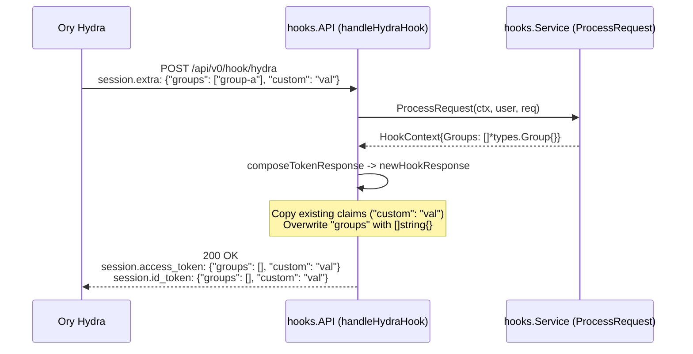

# Design: Clear Stale Groups in Token Hook Response

## Context

See `proposal.md` for problem motivation.

In `pkg/hooks/handlers.go`, `API.composeTokenResponse` extracts existing session claims from `req.Session.Extra` (access token) and `req.Session.DefaultSession.Claims.Extra` (ID token). It passes those maps to `API.newHookResponse`, which copies all existing keys into `resp.Session.AccessToken` and `resp.Session.IDToken`.

Currently, `API.newHookResponse` returns early when `len(groups) == 0` (`pkg/hooks/handlers.go:175-177`). During an OAuth2 `refresh_token` grant, Ory Hydra populates `req.Session.Extra` and `req.Session.DefaultSession.Claims.Extra` with the claims stored from the previous token issuance. Because `API.newHookResponse` returns before overwriting the `"groups"` key when `len(groups) == 0`, the response echoes the stale `"groups"` slice back to Ory Hydra.



## Goals / Non-Goals

**Goals:**
- Ensure `API.newHookResponse` always overwrites `"groups"` in both `resp.Session.AccessToken` and `resp.Session.IDToken`.
- Ensure empty group lists serialize to JSON `[]` rather than `null`.
- Repair the defective session comparison assertion in `pkg/hooks/handlers_test.go`.

**Non-Goals:**
- Modifying `Service.ProcessRequest`, `StorageHookGroupsClient`, or OpenFGA authorization checks.
- Changing how `composeTokenResponse` sets `tenant_id`.

## Decisions

### 1. Unconditionally set `"groups"` to a non-nil `[]string` slice

When `len(groups) == 0`, `API.newHookResponse` will assign an empty, non-nil slice (`[]string{}`) to `resp.Session.AccessToken["groups"]` and `resp.Session.IDToken["groups"]`. When `len(groups) > 0`, `API.newHookResponse` will deduplicate group names and assign the resulting `[]string` slice to both maps.

```go
gg := make([]string, 0)
if len(groups) > 0 {
	groupNames := make(map[string]struct{}, len(groups))
	for _, g := range groups {
		groupNames[g.Name] = struct{}{}
	}
	gg = slices.Collect(maps.Keys(groupNames))
}

resp.Session.AccessToken["groups"] = gg
resp.Session.IDToken["groups"] = gg
```

**Alternatives considered:**
- **Delete `"groups"` from both maps when `len(groups) == 0` (`delete(resp.Session.AccessToken, "groups")`)**: Rejected. Downstream consumers and relying parties expect a deterministic array claim (`"groups": []`) for authenticated subjects. Explicitly writing `"groups": []` also makes the hook's ownership of the `"groups"` claim unambiguous in logs and tests.
- **Assign a `nil` slice (`var gg []string`) when `len(groups) == 0`**: Rejected. In Go, `json.Marshal` serializes a `nil` slice as `null` (`"groups": null`), whereas `[]string{}` serializes as `[]` (`"groups": []`). Returning an empty JSON array keeps the claim type consistent (`array`) regardless of group count.

### 2. Repair unit test helpers and assertions in `pkg/hooks/handlers_test.go`

In `pkg/hooks/handlers_test.go`, two defects currently mask session claim bugs:
1. `createHookResponse` (`pkg/hooks/handlers_test.go:70-89`) only populates `r.Session.AccessToken["groups"]` and never sets `r.Session.IDToken["groups"]`.
2. `TestHandleHydraHook` (`pkg/hooks/handlers_test.go:378`) uses an inverted condition (`if reflect.DeepEqual(resp.Session, test.expectedResponse.Session)`) that fails when the response matches and passes when the response differs. This occurred because `json.Unmarshal` decodes JSON arrays into `[]interface{}` inside `map[string]interface{}`, while `createHookResponse` stored `[]string`.

We will update `createHookResponse` to set `"groups"` on both `AccessToken` and `IDToken` (using `[]interface{}` to match unmarshaled JSON types, or normalizing through JSON marshaling/unmarshaling) and invert the assertion in `TestHandleHydraHook` to `!reflect.DeepEqual(...)` (with order-independent group slice comparison where needed).

**Alternatives considered:**
- **Keep `TestHandleHydraHook` unchanged and only add a new test for `newHookResponse`**: Rejected. Leaving the inverted `reflect.DeepEqual` check in `TestHandleHydraHook` keeps existing HTTP handler tests broken.

### 3. Architecture and Operational Considerations

- **Database schema modifications**: None. This change operates entirely on in-memory HTTP request and response structures in `pkg/hooks`.
- **Security**: Revoking a user's last group membership now immediately clears the `groups` claim on the next token refresh, preventing privilege retention in downstream applications that inspect token claims.
- **Performance**: Allocating a zero-length `[]string{}` slice on empty group responses adds zero heap allocations in Go (`make([]string, 0)` points to the runtime zero-size address).
- **Observability**: The `groups.count` OpenTelemetry span attribute in `API.handleHydraHook` already records `len(hctx.Groups)` (`0` when empty) and requires no changes.
- **Scalability**: The handler remains stateless and introduces no additional I/O or lock contention.

## Risks / Trade-offs

- **[Risk] Downstream consumers checking for missing `groups` key instead of empty array `[]`** → **Mitigation**: Standard OAuth2/OIDC claim parsers treat an empty array `[]` and an absent key identically as zero group memberships.
- **[Risk] Map key iteration order in `maps.Keys(groupNames)` is non-deterministic for multi-group responses** → **Mitigation**: Sort or compare group slices in unit tests without order sensitivity (or sort `gg` with `slices.Sort(gg)` so output is deterministic across runs).

## Migration Plan

1. Deploy the updated `hook-service` binary or container image (`pkg/hooks` change only).
2. Run no database migrations or configuration changes.
3. Roll back to the previous image if unexpected token claim issues occur.
