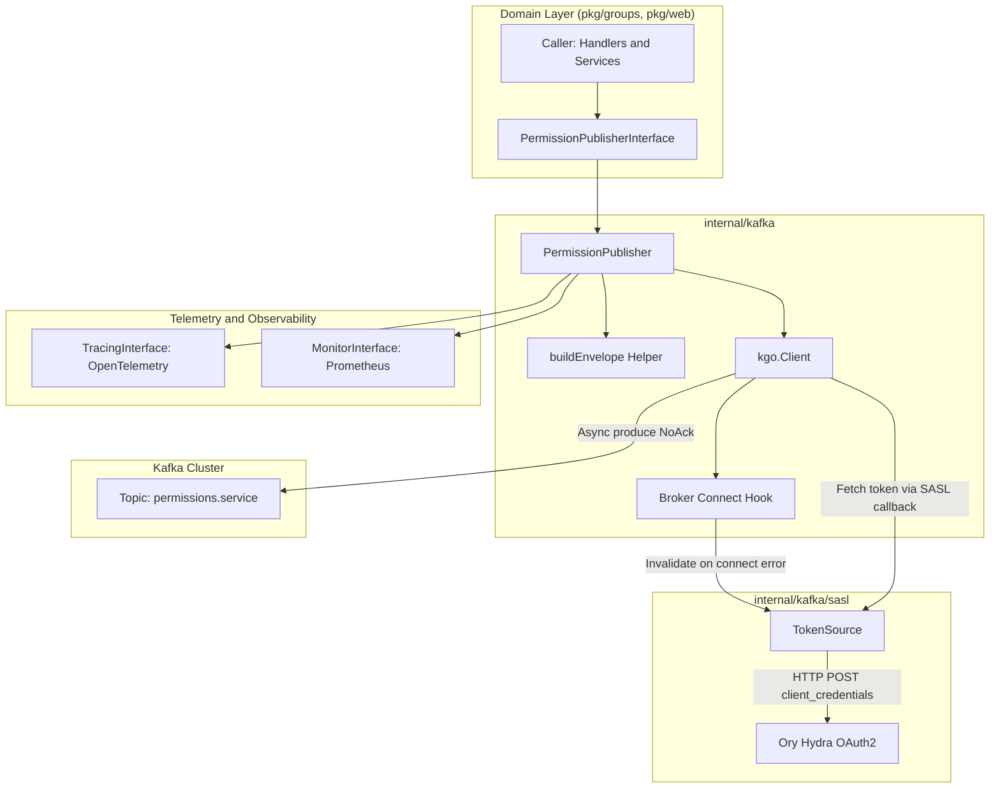
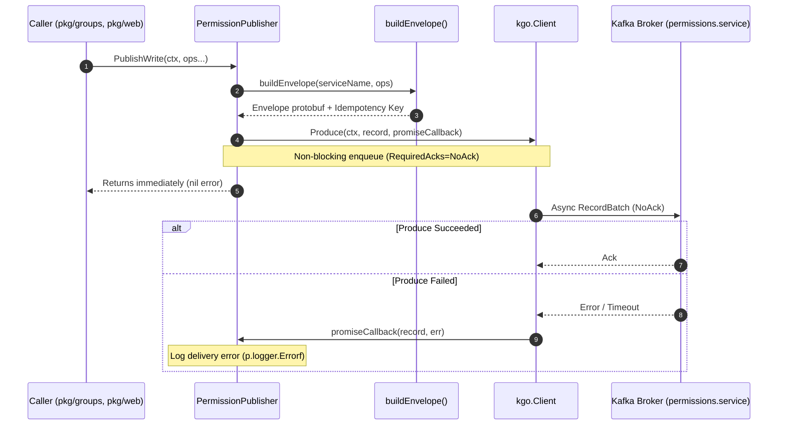
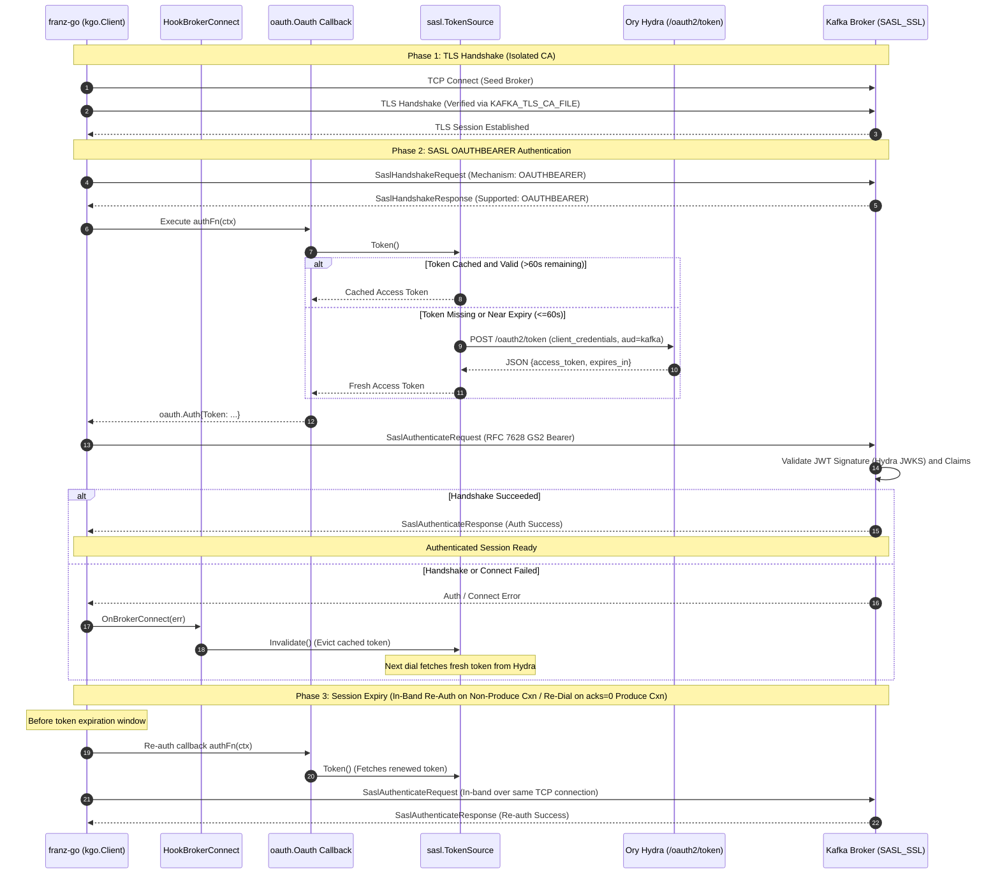

## Context

`hook-service` includes an internal Kafka publishing package (`internal/kafka`) used to stream permission mutations (`PermissionUpdateEnvelope`) to an authorization synchronization topic. The existing implementation is built on `segmentio/kafka-go`, which is dormant and unmaintained.

The current implementation suffered from:
1. **Leaked vendor types in interfaces**: `KafkaWriterInterface` leaked `kafkago.Message` into `internal/kafka/interfaces.go` purely to support `mockgen`.
2. **Artificial type assertions**: `newPublisher` accepted an interface, then type-asserted it back to `*kafkago.Writer` to attach completion callbacks.
3. **Manual SASL OAUTHBEARER**: 116 lines of custom RFC 7628 GS2 header framing and challenge response parsing in `internal/kafka/sasl/oauthbearer.go`.
4. **No KIP-368 re-authentication**: Required a forced 5-minute idle connection timeout on `kafkago.Transport` to cycle TCP connections so token updates would be picked up.

Migrating to `twmb/franz-go` modernizes this subsystem with clean architecture, zero leaky vendor types, and native SASL support.

---

## Package Comparison: `segmentio/kafka-go` vs `twmb/franz-go`

| Dimension | `segmentio/kafka-go` | `twmb/franz-go` | Architectural & Operational Impact |
| :--- | :--- | :--- | :--- |
| **Maintenance & Community** | 🔴 **Dormant / Unmaintained**. Infrequent releases, slow bug triage, no roadmap for modern Kafka protocol features or KIPs. | 🟢 **Actively Maintained**. Industry standard pure Go client (used by Redpanda, Vector, etc.) with prompt bug fixes and immediate adoption of modern KIPs. | Eliminates long-term operational and security risks from unmaintained dependencies. |
| **Client Architecture** | 🟡 **Split Clients**. `kafka.Reader`, `kafka.Writer`, and `kafka.Conn` each manage separate connections, dials, and metadata. | 🟢 **Unified `*kgo.Client`**. Single connection pool per broker, shared coordinator tracking, and shared metadata across producing and consuming. | Significantly lower socket, goroutine, and memory footprint in production. |
| **SASL / OAUTHBEARER** | 🔴 **No native OAUTHBEARER**. Requires writing a custom `sasl.Mechanism` and `StateMachine`, manual RFC 7628 header formatting, and custom error parsing. | 🟢 **Built-in `pkg/sasl/oauth`**. RFC 7628 compliant. Supports dynamic token refresh callbacks (`Oauth(authFn)`) and native KIP-368 connection re-auth. | Eliminates ~150 lines of bespoke, error-prone SASL wire-formatting code in `hook-service`. |
| **Connection Re-auth (KIP-368)** | 🔴 **Not Supported**. Unable to re-authenticate active TCP sockets; forced recycling connections via a 5-minute `IdleTimeout`. | 🟢 **Native KIP-368 Support**. Transparently renegotiates credentials in-band over active TCP sessions for non-produce connections before token expiration. With `NoAck`, produce connections are re-dialed on session expiry. | Reduces connection churn on coordinator/metadata connections and automates token rotation without bespoke recycling hacks. |
| **Interface Design & Idioms** | 🟡 Encourages artificial abstraction wrappers (`KafkaWriterInterface` with `kafkago.Message`), leaking vendor structs into domain packages. | 🟢 Idiomatic functional options (`kgo.Opt`), struct-based configuration, and direct encapsulation without interface pollution. | Aligns directly with AGENTS.md clean-architecture rules against interface pollution. |
| **Durability & Ack Semantics** | 🟡 `RequiredAcks` (`RequireNone`, `RequireOne`, `RequireAll`). In `Async: true`, `WriteMessages` swallows delivery errors and queues into unbounded slices. | 🟢 Explicit `kgo.RequiredAcks(kgo.NoAck())`, `kgo.LeaderAck()`, `kgo.AllISRAcks()`. Asynchronous dispatch uses `cl.TryProduce(ctx, rec, promise)` with bounded memory. | Asynchronous dispatch provides client-side error reporting per record (buffer saturation, metadata failure, timeout). Broker-side produce errors are not visible under `NoAck`. |
| **Memory & Allocation Profile** | 🟡 Moderate allocations. High GC pressure under heavy throughput due to unbounded slice reallocations. | 🟢 Efficient pure Go client with internal buffer pooling and bounded memory queues (`MaxBufferedRecords`). Minimal external dependencies (`klauspost/compress`, `pierrec/lz4`). | Bounded memory footprint and predictable overhead during high-frequency webhook events. |
| **Observability & Telemetry** | 🟡 Manual wrapping and custom stats polling (`WriterStats`, `ReaderStats`). | 🟢 Rich plugin ecosystem: `plugin/kotel` (OpenTelemetry tracing/metrics), `plugin/kprom` (Prometheus), `plugin/kslog`. | Native distributed trace context propagation (W3C traceparent) across producer and consumer. |
| **Consumer Group Protocols** | 🟡 Eager rebalancing only (`Range` / `RoundRobin`), causing "stop-the-world" partitions pauses on rebalance. | 🟢 Supports **Cooperative Sticky Rebalance** (`CooperativeStickyBalancer`) and KIP-848 next-gen consumer protocol. | Ahead-of-time readiness for `authorization-service` consumer migration without pipeline stalls. |
| **Admin Operations** | 🔴 Rudimentary. Creating topics requires dialing an arbitrary broker, finding the controller, and dialing the controller separately. | 🟢 First-class `pkg/kadm`. Reuses established TLS/SASL broker connections to manage topics, partitions, and ACLs. | Simplifies integration test setup and future cluster admin tooling. |

---

## Pros and Cons of Each Package

### `segmentio/kafka-go`

**Pros:**
- Familiarity in existing codebase.
- Simple, high-level `Reader` and `Writer` abstractions for rudimentary use cases.
- 100% pure Go (no CGo required).

**Cons:**
- **Unmaintained Status**: Dormant repository with no roadmap for critical bug fixes or modern Kafka protocol features.
- **Bespoke SASL Maintenance**: Requires hand-rolled RFC 7628 GS2 byte formatting (`n,,\x01auth=Bearer ...\x01\x01`) and manual challenge response parsing in application code.
- **No KIP-368 Re-authentication**: Cannot re-authenticate long-lived connections. Requires forcing an artificial 5-minute connection recycling timeout (`IdleTimeout = 5 * time.Minute`), causing periodic TCP teardowns and reconnect latency spikes.
- **Leaky Interfaces**: Encouraged artificial interfaces like `KafkaWriterInterface` that leaked vendor structs (`kafkago.Message`) into package interfaces solely to support `mockgen`.
- **Memory Buffering Risks**: Internal batch queues rely on unbounded slices in asynchronous mode, risking unbounded memory growth during broker outages.
- **Eager Consumer Rebalances**: Lacks cooperative sticky rebalancing, forcing full pipeline stalls whenever consumer instances scale or restart.

### `twmb/franz-go`

**Pros:**
- **Actively Maintained & Modern**: Developed by Kafka protocol specialists, adopted by major infrastructure projects (Redpanda, Vector), supporting Kafka versions 0.8 through 3.9+ and modern KIPs.
- **Native SASL OAUTHBEARER**: Built-in `pkg/sasl/oauth` package fully implements RFC 7628, eliminating custom framing code and integrating cleanly with dynamic token callbacks.
- **Native KIP-368 Session Re-authentication**: Renegotiates OAuth tokens in-band over active TCP sessions for metadata and coordinator connections. With `NoAck`, produce connections are re-dialed upon session expiry using the fresh token from `TokenSource`.
- **Unified & Resource-Efficient**: Single `*kgo.Client` manages connection pooling, metadata discovery, producing, and consuming with internal buffer reuse and minimal memory overhead.
- **Clean Idiomatic Go Design**: Promotes clean architecture by encapsulating the client directly into domain publishers, eliminating leaky vendor interfaces, and enabling pure testable helpers (`buildEnvelope`).
- **Rich Observability**: Native `plugin/kotel` provides zero-touch W3C traceparent injection and extraction across Kafka message headers.
- **Ahead-of-Time Strategic Value**: Establishes a unified Kafka client foundation that can be adopted across both `hook-service` (producer) and `authorization-service` (consumer).

**Cons:**
- **Migration Scope**: Requires updating producer wiring, test suites, and mock patterns in `internal/kafka`.
- **API Model Shift**: Uses functional options (`kgo.Opt`) and per-record completion promises (`cl.Produce(ctx, rec, promise)`) rather than batch slice writing (`writer.WriteMessages(ctx, msgs...)`), requiring deliberate idiomatic redesign.

---

## Key Design Notes & Strategic Decisions

### 1. Durability Semantics: Preserving `NoAck` in this Iteration
- **Context & Decision**: `hook-service` currently publishes permission events using `RequiredAcks: RequireNone` (`NoAck`). In this migration, we intentionally preserve `kgo.RequiredAcks(kgo.NoAck())`.
- **Design Rationale**:
  - `hook-service` operates as a webhook endpoint for Ory Hydra and identity events. Webhook response latency must stay within sub-millisecond bounds.
  - In coarse-grained authorization mode, PostgreSQL remains the authoritative source of truth, and Kafka publishing operates in a non-blocking standby capacity.
  - Upgrading durability to `LeaderAck` or `AllISRAcks` will be evaluated as an independent architectural decision once end-to-end authorization synchronization requirements are formally defined.
- **Upgrade Path**: When strict at-least-once delivery is mandated, `franz-go` allows changing a single configuration option to `kgo.RequiredAcks(kgo.LeaderAck())` or `kgo.RequiredAcks(kgo.AllISRAcks())`, paired with either synchronous waiting (`ProduceSync`) or bounded asynchronous ack tracking.

### 2. Asynchronous Produce with Promise Callbacks and Fail-Fast Buffering
- **Context & Decision**: We retain asynchronous dispatch via `cl.TryProduce(context.WithoutCancel(ctx), record, promise)` with bounded memory queuing (`kgo.MaxBufferedRecords(10000)`) rather than switching to blocking synchronous produce (`ProduceSync`) or blocking produce (`Produce`).
  - Calling `cl.TryProduce` enqueues the record into `franz-go`'s internal batch buffer and returns immediately, ensuring webhook request execution is never blocked on Kafka network round-trips, batch lingering intervals (`Linger`), or buffer limits.
  - To prevent request context cancellation from canceling in-flight batches waiting in the linger queue, the context passed to the client is detached via `context.WithoutCancel(ctx)`. Total delivery lifetime is bounded by `kgo.RecordDeliveryTimeout(30 * time.Second)`.
  - When the client buffer reaches capacity (`MaxBufferedRecords(10000)`), `cl.TryProduce` immediately fails fast by calling the completion promise with `kgo.ErrMaxBuffered` without blocking the caller goroutine.
  - Unlike `kafka-go` (which swallowed delivery errors in async mode unless `Writer.Completion` was wired), `franz-go` invokes the promise callback with `(*kgo.Record, error)` as soon as the broker acknowledges, times out, or fails the record.
  - In the promise callback, delivery failures are logged at the edge via `p.logger.Errorf`, providing full visibility into write errors without impacting HTTP callers or violating database isolation.

### 3. OpenTelemetry Strategy: Postponing `plugin/kotel` for Coordinated Alignment
- **Context & Decision**: `twmb/franz-go/plugin/kotel` provides native OpenTelemetry integration. We intentionally postpone adopting `plugin/kotel` in this initial producer PR.
- **Design Rationale**:
  - `plugin/kotel` automatically injects W3C `traceparent` headers into Kafka record headers on produce and extracts them in consumer handlers, enabling distributed end-to-end trace visualization from `hook-service` through Kafka to `authorization-service`.
  - Adopting `kotel` unilaterally on the producer side adds new dependencies and trace header formats before the consumer (`authorization-service`) is upgraded to extract them.
  - Postponing `kotel` keeps this PR focused strictly on replacing the core Kafka client engine, eliminating unmaintained code, and establishing native SASL authentication.
  - **Future Plan**: `kotel` will be adopted simultaneously across `hook-service` and `authorization-service` when `authorization-service` is migrated to `franz-go`, ensuring a consistent, end-to-end distributed tracing rollout.

### 4. Phased Migration Strategy: Producer First, Consumer Ahead-of-Time
- **Context & Decision**: This change is strictly scoped to `hook-service` (the producer). `authorization-service` (the consumer) is not modified in this change.
- **Design Rationale**:
  - The Apache Kafka wire protocol is fully standardized and backward-compatible. A `franz-go` producer communicates seamlessly with brokers and `kafka-go` consumers without coordination.
  - Ahead-of-time exploration of `authorization-service` confirmed that consumer concepts (cooperative sticky rebalances, manual offset commits via `CommitRecords`, and consumer group partition assignment) map cleanly to `franz-go`.
  - Phasing the migration isolates failure domains and ensures each service can be verified, load-tested, and deployed independently in production.

### 5. Brand-New Idiomatic Client Design (Not a "Drop-In" Shim)
- **Context & Decision**: This migration is not a superficial syntax replacement; it is a clean-slate idiomatic Go redesign following SOLID principles and AGENTS.md conventions.
- **Design Rationale**:
  - **Eliminating Interface Pollution**: In the legacy code, `KafkaWriterInterface` was created solely to allow `mockgen` to mock `kafka-go`. This leaked `kafkago.Message` into `internal/kafka/interfaces.go` and required artificial type assertions in `newPublisher`. In `franz-go`, `PermissionPublisherInterface` remains the sole public boundary consumed by callers (`pkg/groups`, `pkg/web`), and `PermissionPublisher` directly encapsulates `*kgo.Client`.
  - **Pure Business Logic Extraction (`buildEnvelope`)**: Protobuf message formatting, single vs. batch operation translation, and SHA-256 idempotency key calculation are factored out into an unexported, pure function:
    ```go
    func buildEnvelope(serviceName string, ops []Operation) (*v1.PermissionUpdateEnvelope, string)
    ```
    This allows 100% of domain serialization and idempotency logic to be verified deterministically in fast unit tests without network mocking or background goroutines.
  - **Strict Standard Library Assertions**: In adherence to AGENTS.md, all tests use the standard library `testing` package exclusively, eliminating all third-party assertion dependencies.

### 6. SASL OAUTHBEARER, KIP-368 Re-Authentication, and Reactive Token Invalidation
- **Context & Decision**: Replacing custom RFC 7628 framing with `franz-go/pkg/sasl/oauth` and wiring `HookBrokerConnect` for reactive token invalidation.
- **Design Rationale**:
  - `franz-go/pkg/sasl/oauth` natively formats GS2 initial client responses and handles broker SASL challenge/response flows, deleting 286 lines of custom framing and test code (`oauthbearer.go`, `oauthbearer_test.go`).
  - **KIP-368 Re-authentication & NoAck Connection Lifecycles**: `franz-go` supports in-band connection re-authentication for non-produce connections. With NoAck, KIP-368 in-place re-auth applies to non-produce connections only. Produce connections are re-dialed on session expiry. Broker-side produce errors are not visible. This eliminates the legacy 5-minute connection recycling hack (`DefaultTransportIdleTimeout = 5 * time.Minute`) while ensuring fresh tokens are automatically picked up across all sockets.
  - **TokenSource Architecture**: `TokenSource` retains proactive renewal (refreshing 60 seconds before expiration) and thread-safe single-flight coalescing (`singleflight.Group`) to ensure multiple concurrent connection dials never stampede Ory Hydra.
  - **Reactive Token Invalidation on Failure**: If a token is revoked out-of-band or rejected by the broker before its expiration time, `HookBrokerConnect` intercepts the SASL error (`errors.Is(err, kerr.SaslAuthenticationFailed)`) and calls `tokenSource.Invalidate()`. This immediately purges the cached token, ensuring subsequent connection retries obtain a fresh token from Ory Hydra rather than repeatedly failing with the stale token.

---

## Goals / Non-Goals

**Goals:**
- Eliminate `KafkaWriterInterface` and encapsulate `*kgo.Client` directly inside `PermissionPublisher`.
- Maintain asynchronous produce behavior (`kgo.Produce` with a completion promise) with `NoAck()`.
- Use `twmb/franz-go/pkg/sasl/oauth` for native OAUTHBEARER authentication, deleting custom RFC 7628 code.
- Invalidate cached tokens automatically via `HookBrokerConnect` upon connection or authentication failures.
- Separate pure serialization and idempotency hashing into a testable `buildEnvelope` function.
- Ensure all existing unit, integration, and E2E tests pass cleanly under standard library assertions.

**Non-Goals:**
- Upgrading to `LeaderAck` or `AllISRAcks` in this change (deferred to future durability work).
- Synchronous blocking produce via `ProduceSync`.
- Adopting `twmb/franz-go/plugin/kotel` OpenTelemetry plugin at this time.
- Migrating `authorization-service` consumer client.
- Database schema changes (PostgreSQL storage is unaffected).

---

## Architecture & Data Flow

### Component Architecture



### Data Flow & Execution Sequence



### Client Connection, TLS & SASL Lifecycle Sequence



---

## Detailed Architectural Decisions

### Decision 1: Direct `*kgo.Client` Ownership over Artificial Wrapper Interfaces
- **Chosen**: `PermissionPublisher` directly owns `*kgo.Client`. Low-level `KafkaWriterInterface` is deleted from `interfaces.go`.
- **Rationale**: `PermissionPublisherInterface` is already the public boundary consumed by callers (`pkg/groups`, `pkg/web`). Wrapping `*kgo.Client` in another interface solely for `mockgen` created leaky abstractions (`kafkago.Message`) and violated AGENTS.md conventions against interface pollution.
- **Alternatives Considered**:
  - *Keep a low-level producer interface with generic structs*: Adds indirection without providing multi-implementation value.
  - *Use `mockgen` on a custom `kgo` wrapper*: Reintroduces the same leaky abstraction problem.

### Decision 2: Pure `buildEnvelope` Helper for Deterministic Unit Testing
- **Chosen**: Extract envelope serialization, protobuf translation, and SHA-256 idempotency key generation into an unexported pure function:
  ```go
  func buildEnvelope(serviceName string, ops []Operation) (*v1.PermissionUpdateEnvelope, string)
  ```
- **Rationale**: The core business logic of the publisher (single vs. batch idempotency keys, deterministic hashing, sorting) can be unit-tested thoroughly without mocking network clients or spinning up background goroutines.
- **Alternatives Considered**:
  - *Testing only via integration tests*: Slower feedback loop and harder to test edge-case inputs (e.g. batch operation permutations).

### Decision 3: Native `twmb/franz-go/pkg/sasl/oauth`
- **Chosen**: Replace `internal/kafka/sasl/oauthbearer.go` with `oauth.Oauth(...)`.
- **Rationale**: `franz-go` natively implements RFC 7628, formats GS2 headers, parses extensions, and supports KIP-368 re-authentication natively. This allows deleting `oauthbearer.go` (116 lines) and `oauthbearer_test.go` (170 lines).
- **Alternatives Considered**:
  - *Porting custom SASL mechanism to `franz-go`'s `sasl.Mechanism`*: Unnecessary maintenance overhead when `franz-go` already provides the standard implementation.

### Decision 4: Asynchronous Produce with Promise Callback and TryProduce
- **Chosen**: Use non-blocking asynchronous produce via `cl.TryProduce(context.WithoutCancel(ctx), record, promise)` with `kgo.RequiredAcks(kgo.NoAck())` and `kgo.MaxBufferedRecords(10000)`.
- **Rationale**: Matches existing contract and operational profile of `hook-service`. Webhook latency remains on the order of microseconds for publishing, while delivery failures are logged asynchronously at the application edge via `p.logger.Errorf`. Because the record context is detached (`context.WithoutCancel`) to prevent in-flight batch cancellation on HTTP request completion, `Produce` would block caller threads indefinitely if the internal buffer filled up during a Kafka outage. Using `TryProduce` guarantees that publishing remains strictly non-blocking (failing fast with `kgo.ErrMaxBuffered` to the completion callback), preserving HTTP availability and enforcing database isolation.
- **Alternatives Considered**:
  - *Standard `Produce`*: Blocks when `MaxBufferedRecords` is reached. Since the context has no cancellation, sustained Kafka outages would hang HTTP/gRPC caller threads indefinitely, leading to service-wide exhaustion.
  - *Synchronous produce (`ProduceSync`)*: Would block HTTP request execution on socket buffer writes and batch linger intervals. Deferred until end-to-end ACK requirements (`LeaderAck`/`AllISRAcks`) are mandated.

### Decision 5: Broker Connect Hook for Stale Token Invalidation
- **Chosen**: Register a `kgo.HookBrokerConnect` implementation on `*kgo.Client` that calls `tokenSource.Invalidate()` whenever broker dialing or SASL negotiation returns an error.
- **Rationale**: If a token is revoked in Ory Hydra or rejected by the broker before its expiration time, invalidating the cached token guarantees subsequent retry attempts pull a fresh token immediately rather than repeating failures with the stale cached token.
- **Alternatives Considered**:
  - *Polling token validity*: Wasteful HTTP calls and complex timers.
  - *No invalidation*: Retries would fail repeatedly until the 60-second early renewal window is reached.

---

## Cross-Cutting System Attributes

### Security
- **Native RFC 7628 Compliance**: SASL OAUTHBEARER authentication is handled by `franz-go/pkg/sasl/oauth`, eliminating custom framing bugs.
- **Isolated CA Truststores**: Broker TLS certificates (`KAFKA_TLS_CA_FILE`) and Hydra OAuth certificates (`KAFKA_OAUTH_CA_FILE`) load into dedicated, isolated `x509.NewCertPool()` instances, strictly avoiding host certificate pool pollution.
- **Immediate Credential Invalidation**: Failed broker handshakes trigger immediate token cache eviction, preventing credentials replay attacks or persistent authentication failures with invalid tokens.

### Performance
- **Memory Pooling and Bounded Allocation**: `franz-go` uses internal buffer pooling and bounded queues (`MaxBufferedRecords(10000)`), reducing GC overhead compared to unbounded slices in `kafka-go`.
- **Sub-Millisecond Webhook Latency**: Asynchronous non-blocking dispatch via `cl.TryProduce` enqueues records and returns immediately to the HTTP webhook handler.
- **Automated Token Rotation and Connection Efficiency**: Native KIP-368 re-authentication and automated token rotation eliminate the legacy 5-minute connection recycling mechanism. In-band re-authentication preserves metadata connections, while `NoAck` produce connections re-dial only when the SASL session expires.

### Observability
- **Context-Bound Spans**: OpenTelemetry tracing spans wrap publication operations with standard `Tracer.Start` and `Tracer.End`.
- **Application Edge Logging**: Delivery failures captured by callback promises are logged with full contextual details at the application edge via `p.logger.Errorf` without bubbling unhandled errors to HTTP clients.

### Scalability & Reliability
- **Bounded Buffer Retries**: Configured with `RecordRetries(maxRecordRetries)` (bounded to 10 attempts) to handle transient broker partition leadership handoffs without infinite buffer accumulation.
- **Coalesced Token Refresh**: `TokenSource` employs `singleflight.Group` to prevent redundant parallel HTTP requests to Ory Hydra during mass connection initialization.
- **Graceful Termination**: `PermissionPublisher.Close()` executes `cl.Flush(ctx)` bounded by `DefaultCloseFlushTimeout` (5 seconds), returning any flush error to the caller for edge logging and ensuring `*kgo.Client.Close()` cleans up connections.

---

## Risks / Trade-offs

- **[Risk] Unflushed buffers on application shutdown** → **Mitigation**: `PermissionPublisher.Close()` issues `cl.Flush(ctx)` bounded by `DefaultCloseFlushTimeout` (5 seconds) prior to closing `*kgo.Client`, propagating flush failures directly to the application edge caller.
- **[Risk] Fire-and-forget message loss under broker crash** → **Mitigation**: Acknowledged trade-off with `NoAck`. Retries are configured (`RecordRetries(maxRecordRetries)`, bounded to 10 attempts) and delivery failures are logged via `p.logger.Errorf` at the edge. Durability can be upgraded to `LeaderAck` in a future change.
- **[Risk] Multiple connection retries hammering Ory Hydra** → **Mitigation**: `TokenSource` uses `singleflight.Group` to coalesce concurrent token requests and has a 10-second bounded outbound HTTP timeout.

---

## Migration & Compatibility

- **Database Changes**: None. PostgreSQL storage is completely decoupled from Kafka messaging.
- **Configuration Compatibility**: All existing environment variables (`KAFKA_BROKERS`, `KAFKA_AUTH_TYPE`, `KAFKA_OAUTH_*`, `KAFKA_TLS_*`) remain identical and parse into `kafka.Config`.
- **Deployment Compatibility**: Backward-compatible with existing Kafka brokers and Ory Hydra OAuth2 endpoints.

---

## Open Questions

1. **Durability Upgrade**: When `hook-service` requires strict at-least-once delivery guarantees for federated authorization synchronization, what is the preferred migration path from `NoAck` to `LeaderAck` with synchronous or bounded asynchronous acknowledgments?
2. **OpenTelemetry Plugin (`kotel`)**: When `authorization-service` also migrates to `franz-go`, should both services adopt `twmb/franz-go/plugin/kotel` simultaneously for uniform distributed trace propagation across the permission pipeline?
3. **Queue Bounding**: Resolved. In-memory queue bounding is configured via `kgo.MaxBufferedRecords(10000)` combined with `cl.TryProduce`. In-memory buffer size is strictly capped to prevent OOM crashes, while `TryProduce` guarantees that buffer saturation fails fast via `ErrMaxBuffered` to the delivery completion callback without blocking HTTP/gRPC caller threads.
